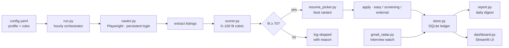

<div align="center">

# 🤖 AI Job Application Automation

### Your autonomous job-hunting engine — it finds the right jobs, scores them, and applies while you sleep.

[](https://www.python.org/)
[](https://playwright.dev/)
[](https://streamlit.io/)
[](LICENSE)

<br/>

> **The problem:** great jobs disappear in hours. Manual applications can't keep up.<br/>
> **The fix:** an engine that scans **Naukri** every hour, scores every fresh listing **0–100** against your profile, and auto-applies to the best matches with a **tailored resume** — while a **Gmail radar** watches for interview invites and drafts your replies.

</div>

---

## ✨ What it does

<table>
<tr><td width="50%">

### 🔍 Discover
Searches Naukri hourly for your target roles — Prompt Engineer, AI Automation, AI Agent, AI Content Generation, AI Video — with a strict **last-24-hours freshness filter**, newest first.

</td><td width="50%">

### 📊 Score
Every listing gets a deterministic **0–100 fit score**: title match (30) · skills overlap (30) · seniority (20) · compensation (10) · listing quality (10). Applies only at **≥ 70**.

</td></tr>
<tr><td>

### 📄 Apply
One-click easy-applies go first; screening-question and external career-page flows are handled too — **only** where no login or OTP is needed. Never guesses an answer it doesn't have.

</td><td>

### 📝 Tailor
Picks the best of **5 truthful resume variants** per role (prompt engineering · AI automation · AI agent · AI video · AI content). Same real experience, tailored emphasis — never fabricated claims.

</td></tr>
<tr><td>

### 📬 Interview Radar
Checks Gmail every 30 minutes for interview invites, shortlists and recruiter outreach. Saves a **draft reply** for your approval — **never auto-sends**.

</td><td>

### 📈 Dashboard
Live Streamlit dashboard: daily quota progress, 7-day trends, a searchable application ledger, and full blocker visibility.

</td></tr>
</table>

---

## 🏗️ Architecture



**Data flow guarantees:**
- 🔁 **Dedupe:** applied listings are never touched twice; blocked ones are retried once the blocker clears
- 🛡️ **Truthfulness:** unknown answers stay blank and get logged as `skipped_question` — the engine would rather skip than lie
- 🚧 **Hard stops:** login walls, CAPTCHAs, OTPs and rate limits stop the run gracefully and report what *you* need to do

---

## 🚀 Quick start

```bash
# 1. Clone and install
git clone https://github.com/itzmoksh01/AI-Job-Application-Automation.git
cd AI-Job-Application-Automation
pip install -r requirements.txt
playwright install chromium

# 2. Configure your profile
cp config.yaml config.local.yaml   # then edit: name, CTC, notice, cities, answers

# 3. Log in once (session persists)
python -m src.run --login-only

# 4. Run the engine
python -m src.run          # single discovery → score → apply cycle
python -m src.dashboard    # live dashboard at localhost:8501
```

> ⏰ **Scheduling:** point your scheduler (cron / Task Scheduler) at `python -m src.run` hourly between your active hours. Sample cron included in `scripts/cron.example`.

---

## ⚙️ Configuration

Everything lives in `config.yaml` — the next run picks up changes automatically:

| Key | Meaning |
|---|---|
| `target_roles` | Roles to hunt (Prompt Engineer, AI Automation, …) |
| `daily_limit` | Max verified applications per day (default **200**) |
| `min_fit_score` | Apply threshold (default **70**) |
| `candidate.*` | Name, contact, CTC, notice, cities, relocation, experience |
| `screening_answers.*` | Pre-locked truthful answers so forms never stall |
| `resume_variants/` | 5 tailored PDFs + master resume fallback |

**Pre-locked screening answers** live in `screening_answers.yaml` — location, CTC, notice period, experience years, relocation willingness, English comfort, portfolio/GitHub/LinkedIn links, and a humanized *"why this role"* template. Answer a question once, and the engine never blocks on it again.

---

## 📁 Project structure

```
├── src/
│   ├── run.py            # hourly run: discover → filter → dedupe → score → apply → log
│   ├── scorer.py         # deterministic 0–100 fit rubric
│   ├── resume_picker.py  # best-variant selection per role
│   ├── naukri.py         # Playwright automation: login, search, apply, external flows
│   ├── store.py          # SQLite ledger (applied / skipped / blocked)
│   ├── report.py         # skimmable daily report from the ledger
│   ├── gmail_radar.py    # interview/recruiter mail detection + reply drafts
│   ├── dashboard.py      # Streamlit dashboard
│   └── config.py         # config loader
├── resumes/              # 5 truthful resume variants
├── scripts/cron.example  # scheduling sample
├── tests/                # unit tests
├── config.yaml           # your profile (copy to config.local.yaml)
└── requirements.txt
```

**Ledger schema** (every listing touched):

```json
{
  "date": "2026-10-03",
  "platform": "naukri",
  "job_title": "AI Automation Engineer",
  "company": "Example Corp",
  "fit_score": 82,
  "fit_reason": "title + skills + seniority match…",
  "resume_variant": "ai_automation.pdf",
  "status": "applied | skipped_low_fit | skipped_question | blocked_*",
  "apply_mode": "easy_apply | screening | external_career_page"
}
```

---

## 🛡️ Safety & ethics by design

- 🔐 **No credentials in code** — you log in once via the real browser; the session persists
- 🤫 **Drafts, never sends** — the Gmail radar only *drafts* replies; every send is your decision
- 🚫 **Stops at walls** — CAPTCHA, OTP, login walls: the run stops and tells you exactly what to do
- ✅ **Truthful applications** — every answer comes from your profile; unknown answers are logged, never invented
- 📵 **Platform scope** — Naukri only, by design

---

## 🧪 Tests

```bash
python -m pytest tests/ -q
```

---

## 📜 License

MIT — use it, fork it, make it yours.

---

<div align="center">

**Built with ❤️ by [Abhishek Goswami](https://github.com/itzmoksh01)** · *Generative AI Specialist*

*If this engine helped your job hunt, ⭐ star the repo!*

</div>
